<h1 align="center">🎫 Shivam Missar</h1>

<p align="center">
  <b>Software Engineer who spends his days inside a ticketing system,<br/>so naturally his GitHub profile is one too.</b>
</p>

<p align="center">
  
  
  
</p>

<p align="center">
  <a href="https://shivammissar.app"></a>
  <a href="https://www.linkedin.com/in/shivam-missar/"></a>
  <a href="mailto:Shivamissar06@gmail.com"></a>
  <a href="https://www.instagram.com/framedbysm/"></a>
</p>

<div align="center">
  <h3><code>shivam@github ~ $ whoami</code></h3>
  <table>
    <tr>
      <td valign="top">
        <picture>
          <source media="(prefers-color-scheme: dark)" srcset="./assets/portrait-dark.svg" />
          
        </picture>
      </td>
      <td valign="top">
        <picture>
          <source media="(prefers-color-scheme: dark)" srcset="./assets/info-card-dark.svg" />
          
        </picture>
      </td>
    </tr>
  </table>
  <br>
  <h3><code>shivam@github ~ $ ./contributions.sh</code></h3>
  <picture>
    <source media="(prefers-color-scheme: dark)" srcset="./assets/contrib-heatmap-dark.svg" />
    
  </picture>
</div>

---

### 🎟️ Ticket #0001 — Request: *"Who is this guy?"*

```yaml
Ticket:      "#0001"
Type:        Service Request
Raised by:   You, a curious visitor
Assigned to: Shivam Missar
Status:      ✅ Resolved below

Summary:
  Role:      Technical Consultant @ XMA
  Strongest: C# · ASP.NET Core · React · SQL
  Degrees:   BSc Software Engineering (First) · MSc Software Development (Merit)
  Motto:     "Can never be satisfied with good, always have to better."
```

### 📝 Resolution Notes

I sit where engineering meets service delivery. At work I write **SQL that does the billing so humans don't have to**, build **workflow automations** that close loops nobody else noticed were open, and craft **HTML emails that survive Outlook**. Outlook is the final boss of front-end development, and I fight it daily.

After hours I turn those day-job headaches into products. Every annoying problem is a side project waiting to happen.

---

### 🚀 Release Notes

```diff
+ v2.0  Ticketmail Builder                        [ IN DEVELOPMENT ]
+       Outlook-safe email template builder for MSPs & PSA tools.
+       Because no one should hand-write <table> layouts in 2026.
+       Stack: React · ASP.NET Core

+ v1.3  Locana                                    [ LIVE ]
+       Local community events board with auth,
+       real-time updates and location filtering.
+       Stack: React · Tailwind · Node.js · Supabase

+ v1.2  NHS Emergency Department Simulation       [ FEATURED BY NHS-R ]
+       Discrete-event simulation of patient flow, built on my NHS internship.
+       Stack: Python · SimPy

+ v1.0  Book Club                                 [ SHIPPED ]
+       Final-year uni project. Full-stack ASP.NET, and where it all started.
+       Stack: C# · ASP.NET
```

👉 **[Try Locana live](https://local-community-events-board-ylos.vercel.app)**

---

### 🧰 Toolkit

**Main character energy**


**Supporting cast**


**Behind the scenes crew**


**Ways of working:** ITIL 4 · Scrum · REST API design

---

### 🐛 Known Issues

```diff
- Cannot leave code at "good enough". Workaround: none found. Won't fix.
- Opens Outlook, sees broken padding, takes it personally.
- Says "one more side project" roughly once a month.
- Will stop mid-walk to take a photo. Proof: @framedbysm 📷
```

---

<p align="center">
  <b>Got a role, an idea, or a bug that needs a stubborn person?</b><br/>
  <a href="mailto:Shivamissar06@gmail.com">Raise a ticket ↗</a>, and I promise to beat the SLA.
</p>
